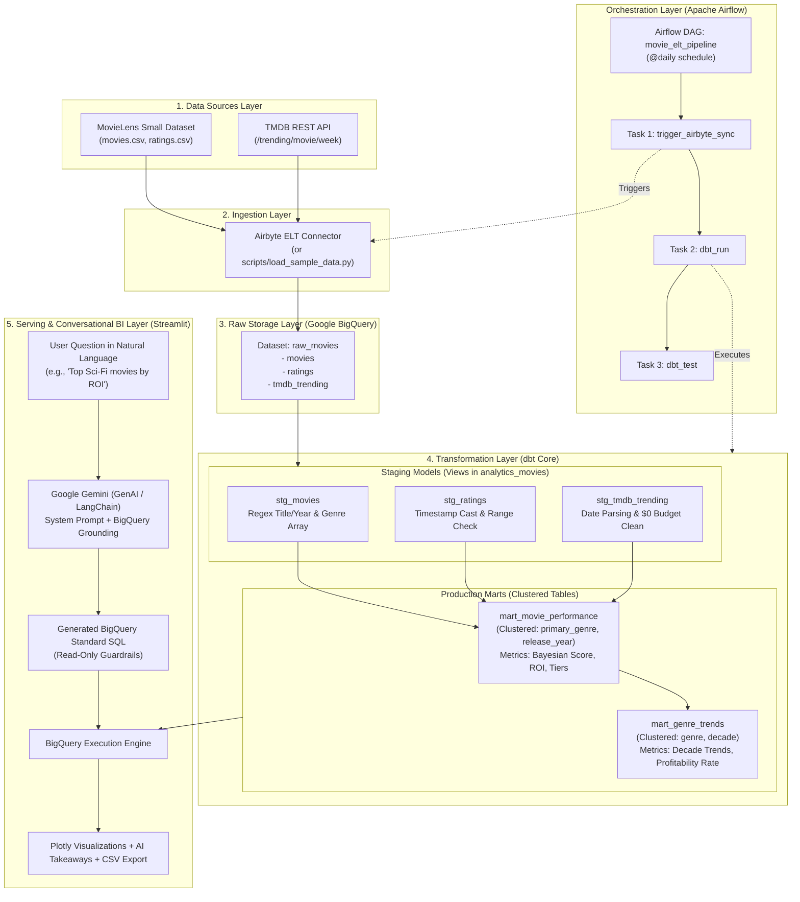

# 🎬 Movie Streaming ELT & Conversational BI — Project Demo Guide

This guide contains the end-to-end architecture breakdown, data schemas, mathematical models, and talking points for demonstrating the project.

---

## 🏛️ 1. Architecture & Data Flow



---

## 🧩 2. Component-by-Component Overview

| Component | Technology | Purpose & Design Decision |
| :--- | :--- | :--- |
| **Data Sources** | MovieLens Small + TMDB API | Combines 100k user ratings with weekly trending box-office financials (budget, revenue). |
| **Ingestion** | Airbyte / `load_sample_data.py` | Follows ELT pattern: loads raw data into BigQuery without pre-processing. |
| **Data Warehouse** | Google BigQuery | Cloud-native serverless DW. Uses clustering on `[primary_genre, release_year]` and `[genre, decade]` for sub-second query performance. |
| **Transformations** | dbt Core v1.7+ | Modular staging views (`stg_*`) and persistent dimensional marts (`mart_*`). Macro for Bayesian rating. |
| **Orchestration** | Apache Airflow v2.8+ | Dockerized `@daily` pipeline: `trigger_airbyte_sync >> dbt_run >> dbt_test`. |
| **Conversational BI**| Streamlit + Google Gemini | Text-to-SQL interface grounded with BigQuery DDL schema. Guardrails enforce strictly `SELECT` queries. |

---

## 🔄 3. Data Transformations & Schemas

| Stage | Table / View | Key Transformation Logic | Output Schema |
| :--- | :--- | :--- | :--- |
| **Raw** | `raw_movies.movies` | Direct ingest from CSV | `movieId`, `title`, `genres` |
| **Raw** | `raw_movies.ratings` | Direct ingest from CSV | `userId`, `movieId`, `rating`, `timestamp` |
| **Raw** | `raw_movies.tmdb_trending` | Direct ingest from JSON API | `id`, `title`, `popularity`, `vote_average`, `budget`, `revenue`, `release_date` |
| **Staging** | `stg_movies` (View) | Regex year extraction `\((\d{4})\)\s*$`, title cleanup, `SPLIT(raw_genres, '\|')` to `ARRAY<STRING>`, deduplication by `movie_id`. | `movie_id`, `title`, `clean_title`, `release_year`, `genre_array` |
| **Staging** | `stg_ratings` (View) | `TIMESTAMP_SECONDS(timestamp)`, filter `rating BETWEEN 0.5 AND 5.0`, deduplication per user/movie. | `user_id`, `movie_id`, `rating`, `rating_timestamp`, `rating_date` |
| **Staging** | `stg_tmdb_trending` (View) | Convert non-positive budget/revenue to `NULL`, safe date parse `YYYY-MM-DD`. | `tmdb_id`, `tmdb_title`, `budget`, `revenue`, `popularity`, `release_date` |
| **Mart** | `mart_movie_performance` (Table) | Aggregates ratings (count, avg, stddev), joins TMDB, computes Bayesian rating & ROI. Clustered by `primary_genre, release_year`. | `movie_id`, `clean_title`, `release_year`, `primary_genre`, `rating_count`, `avg_rating`, `bayesian_weighted_score`, `budget`, `revenue`, `return_on_investment`, `financial_status`, `rating_tier` |
| **Mart** | `mart_genre_trends` (Table) | `CROSS JOIN UNNEST(genre_array)`, `FLOOR(release_year/10)*10` for decade cohorts, aggregations for revenue, avg ROI, profitability rate. Clustered by `genre, decade`. | `genre`, `decade`, `decade_label`, `total_movies`, `total_ratings`, `avg_bayesian_score`, `total_revenue`, `avg_return_on_investment`, `profitability_rate` |

---

## 🧮 4. Core Mathematical Formulations

### 1. Bayesian Weighted Rating Score (IMDb Formula)
$$WR = \left(\frac{v}{v + m}\right) \cdot R + \left(\frac{m}{v + m}\right) \cdot C$$
- $v$ = Number of ratings (`rating_count`)
- $m$ = Minimum rating threshold ($m = 25.0$)
- $R$ = Average movie rating (`avg_rating`)
- $C$ = Global mean rating across catalog ($C \approx 3.53$)

### 2. Return on Investment (ROI)
$$\text{ROI} = \frac{\text{Revenue} - \text{Budget}}{\text{Budget}}$$
Implemented in SQL:
```sql
ROUND(SAFE_DIVIDE((revenue - budget), NULLIF(budget, 0)), 4) AS return_on_investment
```

---

## 🎬 5. Demonstration Script (What to Show & Say)

1. **BigQuery Console**: Show datasets `raw_movies` and `analytics_movies`. Highlight the clustered tables.
2. **Terminal**: Run `dbt test --profiles-dir .` in `dbt_movies/` to show 10+ passing data quality assertions.
3. **Airflow UI**: Show the `movie_elt_pipeline` DAG running `@daily` with its 3 tasks.
4. **Streamlit App**: Run `streamlit run bi_app/app.py`. Ask:
   - *"Top 5 highest-rated Sci-Fi movies with at least 100 ratings"*
   - *"Show the top 10 movies by Bayesian weighted rating score"*
   - *"Compare average ROI and total revenue across genres in the 2010s"*
